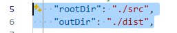

# 202602_js_lfsb_10
Ciclo 2026-02 UA Laboratorio 10
## Clonar
```
git clone -b "feat(implementacion)" https://github.com/mgabrieleProfesorUA/202602_js_lfsb_10.git
```
## Cambiar el tipo a module del archivo package.json


## instalar modulos NPM
```
npm install typescript --save-d
```
## Instalar TypeScript Config (tsconfig.json)
```
npx tsc -init
```
## Descomentar las lineas relacionadas al Source (src) y Distribution (dist) del archivo tsconfig.json


## Compilar proyecto TypeScript
```
npx tsc
```
## Ejecutar
```
node .\dist\Injection\SI_DI\UserServiceDI.js
```
